# REloaded - TryHackMe Writeup

## Overview
- **Room**: REloaded
- **Difficulty**: Hard
- **Category**: Reverse Engineering
- **Platform**: Windows PE x86 Binaries
- **Tools Used**: Linux CLI (`strings`, `objdump`, `python3`), NSA Ghidra
- **Description**: This room is dedicated to progressive reverse engineering challenges. Each level introduces unique reverse engineering concepts—from basic string enumeration and cross-referencing to binary patching, stack string deobfuscation, and encryption algorithm analysis.

---

## Challenge Summary & Solutions

| Task | Level | Core Concept | Target Answer |
|---|---|---|---|
| **Task 1** | Level 0 | Plaintext binary enumeration | `L3v3lZ340_is_D02e` |
| **Task 2** | Level 1 | XREF analysis & Hex conversion | `1709` |
| **Task 3** | Level 2 | Binary patching & Authentication bypass | Flag: `L3_1s_20t_Th3_L131t`<br>Instruction: `jnz` |
| **Task 4** | Level 3 | Stack string analysis & XOR reversing | `THMctf-L4` |
| **Task 5** | Level 4 | CRT startup tracing & Plaintext extraction | `Alan Turing Was a Genius` |

---

## Task 1: Level 0 (Basic Binary Enumeration)

### Objective
Enumerate the executable `Level-0.exe` and retrieve the hidden flag.

### Analysis & Solution
Since this is an introductory reverse engineering challenge, the flag is not encrypted or obfuscated and resides directly within the binary's readable text sections.

Using the Linux `strings` utility combined with a regular expression filter for strings between 10 and 100 characters:

```bash
strings Level-0_1610287551028.exe | grep -E '.{10,100}'
```

### Execution Evidence
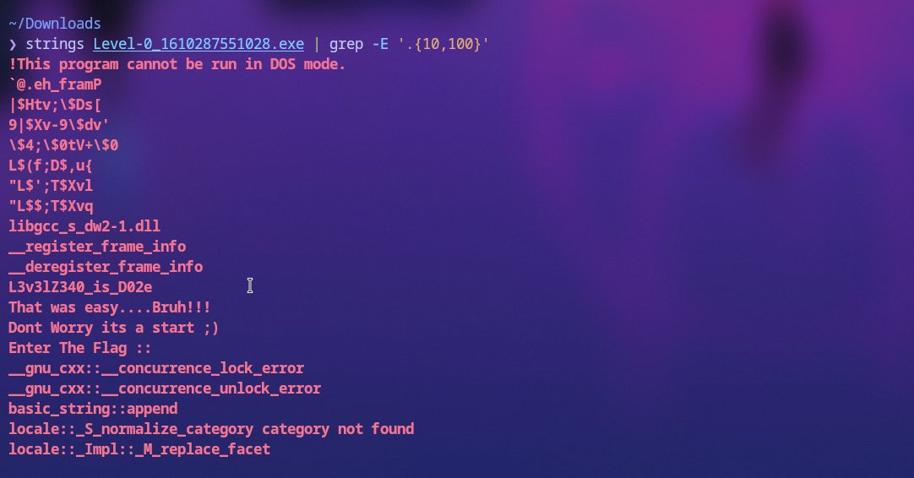

From the output, the string immediately preceding the comparison indicators (`"That was easy....Bruh!!!"` and `"Enter The Flag :: "`) stands out as the flag:
- **Flag**: `L3v3lZ340_is_D02e`

---

## Task 2: Level 1 (Control Flow & XREF Analysis)

### Objective
Find the "lucky number" required to satisfy the validation logic in `Level-1.exe`.

### Analysis & Methodology

Running `strings` on `Level-1.exe` reveals landmark strings such as `"Thats ur lucky number !!!"` and `"Try again "`, but no plaintext flag. We use cross-reference (XREF) analysis in **Ghidra** and **objdump** to identify where this string is used.

#### Step 1: Locating the Landmark String
In Ghidra, opening **Defined Strings** (`Window` → `Defined Strings` or pressing `S`) and searching for `"lucky"` reveals the string at virtual address **`0x004b1045`**.

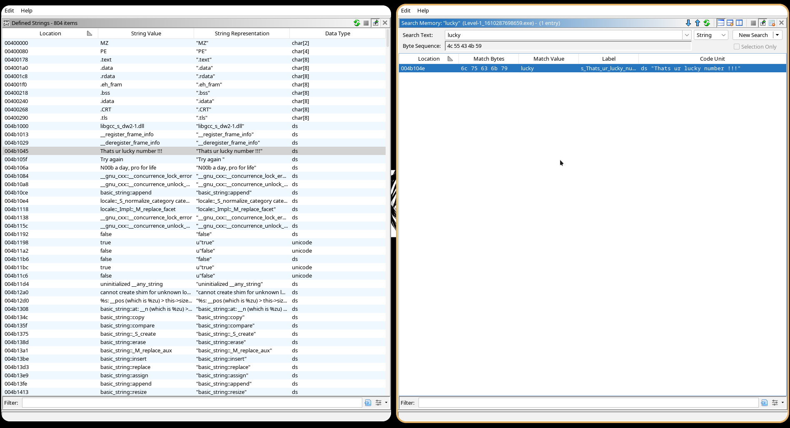

#### Step 2: Cross-Reference (XREF) Tracing
Right-clicking the string at `004b1045` and selecting **References → Show References to Address** reveals a single reference inside function `FUN_00401410` at address `0040141f`:

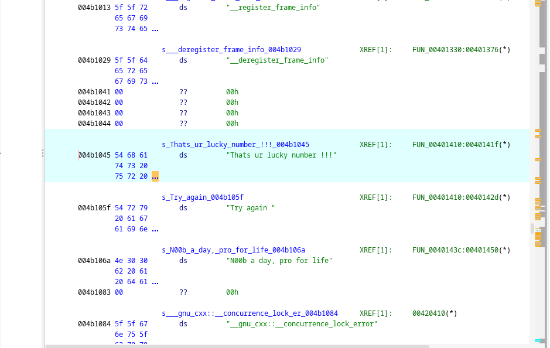

#### Step 3: Decompilation & Hex Decoding
Inspecting `FUN_00401410` in the Decompiler reveals:

```c
void __cdecl FUN_00401410(int param_1)
{
    if (param_1 == 0x6ad) {
        printf("Thats ur lucky number !!!");
    }
    else {
        puts("Try again ");
    }
    return;
}
```

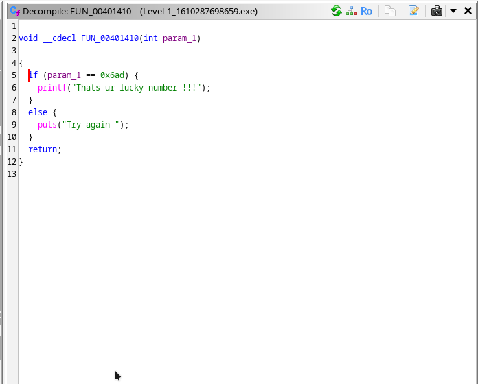

The application compares the user's integer parameter `param_1` against hexadecimal constant `0x6ad`. Converting this value to decimal:

```bash
python3 -c "print(int('0x6ad', 16))"
# Output: 1709
```

- **Answer**: `1709`

---

## Task 3: Level 2 (Authentication Bypass & Binary Patching)

### Objective
Bypass the authentication mechanism in `Level-2.exe` to retrieve the flag, and identify the modified assembly instruction.

### Analysis & Methodology

#### Step 1: Locating the Authentication Routine
Searching defined strings for `"Get Ready For L4 ;)"` leads to function `FUN_00401410` (called during authentication validation).

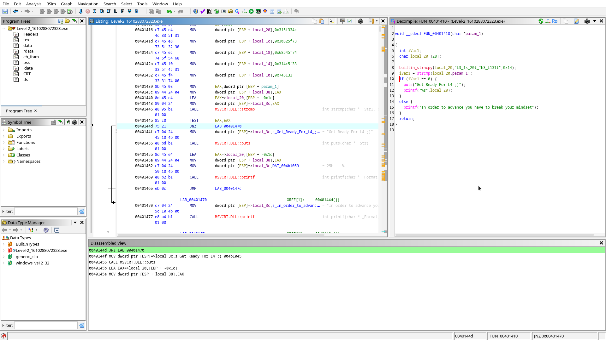

In the Decompiler, user input `param_1` is compared with `local_20` via `strcmp`:
```c
void __cdecl FUN_00401410(char *param_1)
{
    int iVar1;
    char local_20 [28];
    
    builtin_strncpy(local_20,"L3_1s_20t_Th3_L131t",0x14);
    iVar1 = strcmp(local_20,param_1);
    if (iVar1 == 0) {
        puts("Get Ready For L4 ;)");
        printf("%s",local_20);
    }
    else {
        printf("In order to advance you have to break your mindset");
    }
    return;
}
```

The expected key stored in `local_20` is:
- **Flag**: `L3_1s_20t_Th3_L131t`

#### Step 2: Instruction Patching Analysis
Looking at the disassembly directly after the `strcmp` call:

```assembly
00401446  e8 95 b1 01 00   CALL  MSVCRT.DLL::strcmp
0040144b  85 c0            TEST  EAX, EAX
0040144d  75 21            JNZ   LAB_00401470
0040144f  c7 04 24...      MOV   dword ptr [ESP], "Get Ready For L4 ;)"
```

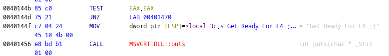

The instruction at `0040144d` is **`JNZ`** (`75 21` — Jump if Not Zero). If the user enters an invalid key, `strcmp` returns non-zero, and `JNZ` redirects execution to `LAB_00401470` (the failure branch). 

To patch the binary and bypass authentication for any arbitrary input, this instruction is inverted to **`JZ`** (`74 21`) or replaced with `NOP`s (`90 90`).

- **Modified Instruction**: `jnz`

---

## Task 4: Level 3 (Stack String Obfuscation & XOR Analysis)

### Objective
Recover the master password/flag from `Level-3.exe` after the author obfuscated the key storage.

### Analysis & Methodology

#### Step 1: Identifying the Validation Routine
Searching for `"Rooted !!!"` leads to `FUN_004014af`:

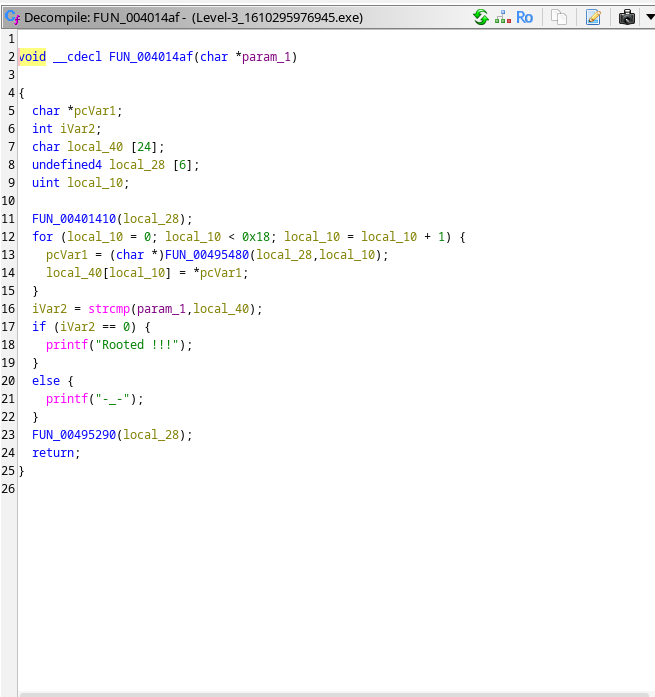

On line 11, `FUN_004014af` calls `FUN_00401410(local_28)` before looping and comparing `local_40` with `param_1` using `strcmp`.

#### Step 2: Stack String Deobfuscation
Navigating into `FUN_00401410` reveals that the author initialized the target string as individual byte and integer constants directly on the stack rather than storing a string literal:

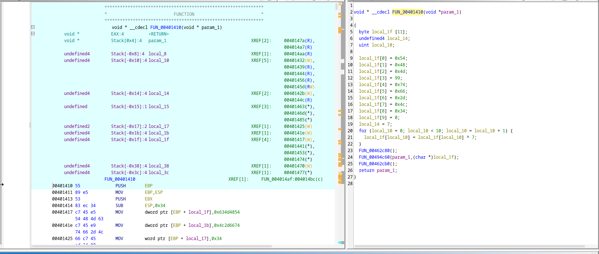

```c
local_1f[0] = 0x54;   // 'T'
local_1f[1] = 0x48;   // 'H'
local_1f[2] = 0x4d;   // 'M'
local_1f[3] = 99;     // 'c'  (0x63)
local_1f[4] = 0x74;   // 't'
local_1f[5] = 0x66;   // 'f'
local_1f[6] = 0x2d;   // '-'
local_1f[7] = 0x4c;   // 'L'
local_1f[8] = 0x34;   // '4'
local_1f[9] = 0;      // '\0'

local_14 = 7;
for (local_10 = 0; local_10 < 10; local_10 = local_10 + 1) {
    local_1f[local_10] = local_1f[local_10] ^ 7;
}
```

Reading the ASCII characters defined in `local_1f[0..8]`:
- `0x54` → `T`
- `0x48` → `H`
- `0x4D` → `M`
- `99`   → `c`
- `0x74` → `t`
- `0x66` → `f`
- `0x2D` → `-`
- `0x4C` → `L`
- `0x34` → `4`

Concatenated together, the plaintext flag is:
- **Flag**: `THMctf-L4`

*(When XORed with key `7` during the loop, the transformed master password produces `SOJdsa*K3`).*

---

## Task 5: Level 4 (CRT Startup Tracing & Encryption Reversing)

### Objective
Recover the plaintext message intercepted from the test encryption binary `Level-4.exe`.

### Analysis & Methodology

Running `Level-4.exe` outputs the encrypted string:
```text
AmcmQBu^YP+`lDV1pvYBdR
```

Since the binary prints this output, it must call `printf` from the C runtime library.

#### Step 1: CRT Startup Tracing to `main`
In a MinGW compiled Windows binary, execution begins at `entry`:

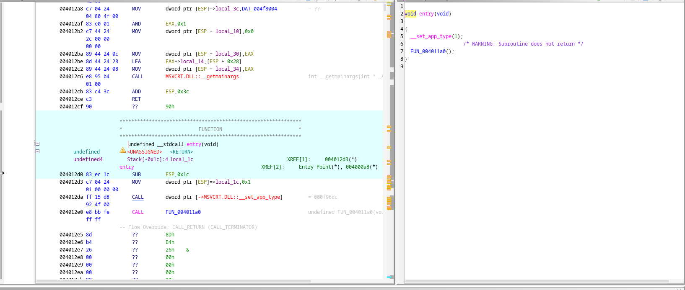

Tracing from `entry` into `FUN_004011a0` (the C-Runtime initialization function), line 26 invokes the application's actual `main()` function:
```c
uExitCode = FUN_004014e6();
```

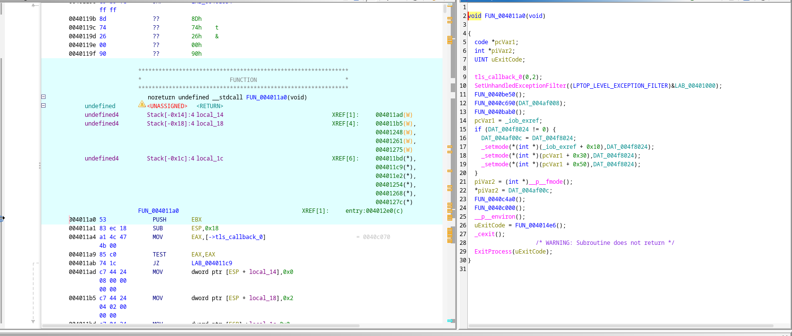

#### Step 2: Recovering Plaintext from `FUN_004014e6`
Navigating into `FUN_004014e6` (`004014e6`) reveals the unencrypted message being loaded into buffer `local_2a` immediately before calling the encryption and display routine `FUN_00401453`:

```c
undefined4 FUN_004014e6(void)
{
    char local_2a [38];
    
    FUN_0040c000();
    builtin_strncpy(local_2a, "Alan Turing Was a Geniuse", 0x1a);
    FUN_00401453(local_2a);
    return 0;
}
```

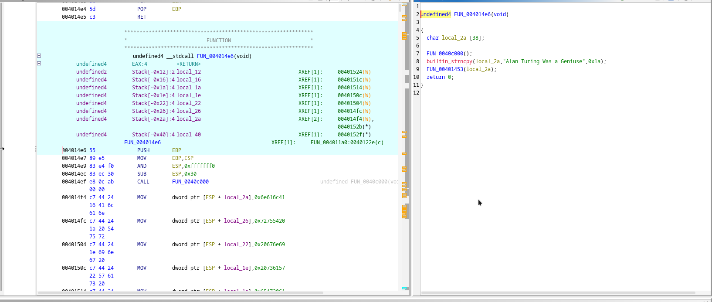

#### Step 3: Understanding the Encryption Routine (`FUN_00401453`)
Inspecting `FUN_00401453`:
1. It iterates through each character of the string at index `i`.
2. It calls helper function `FUN_00401410(i)`, which tests whether index `i` is a **prime number** (mimicking the hint `"Agent 35711"`):
   - If `i` is prime: `char = char ^ i`
   - If `i` is composite: `char = char ^ 0x37`
3. Printing the transformed characters generates the ciphertext `AmcmQBu^YP+`lDV1pvY^BdR`.

The original unencrypted flag string is:
- **Flag**: `Alan Turing Was a Genius`

---

## Conclusion

The **REloaded** room on TryHackMe provides a comprehensive progression through essential reverse engineering methodologies:
1. **Level 0**: String enumeration and identifying embedded secrets.
2. **Level 1**: Tracing cross-references (XREFs) to map user input against hardcoded hex comparison values.
3. **Level 2**: Analyzing control flow logic and modifying conditional jump instructions (`JNZ` → `JZ`) to bypass authentication checks.
4. **Level 3**: Reconstructing stack strings constructed through byte arrays and reversing XOR loops.
5. **Level 4**: Navigating compiler runtime entry routines (`entry` → `main`) and reversing custom prime-indexed XOR encryption algorithms.
