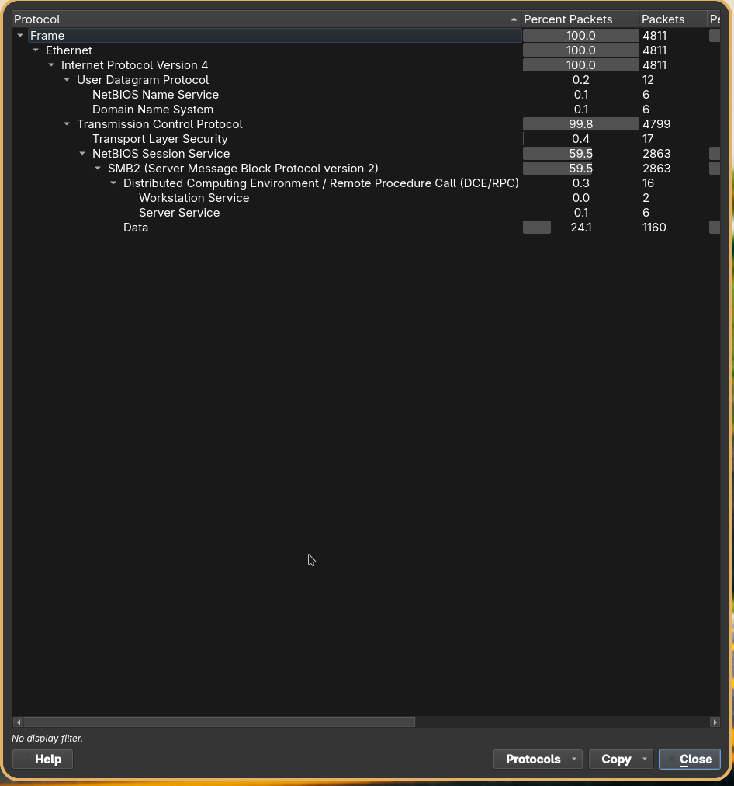
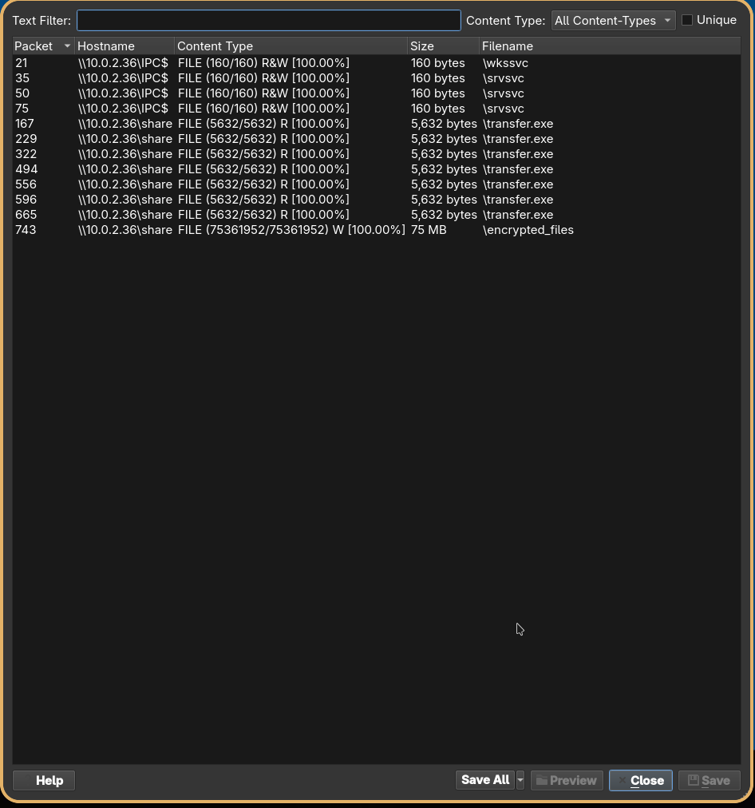
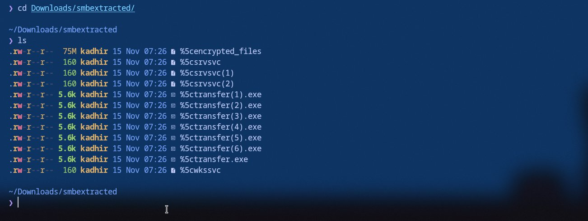
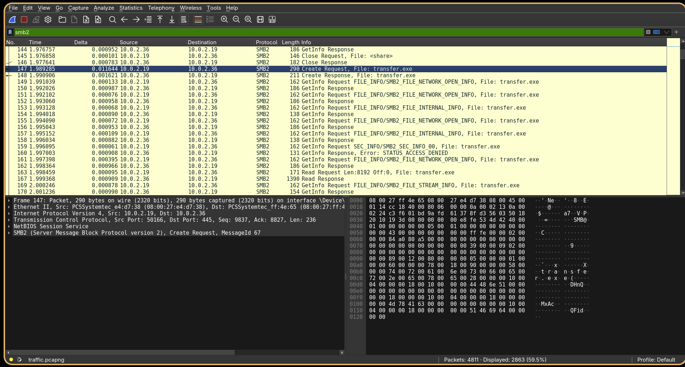
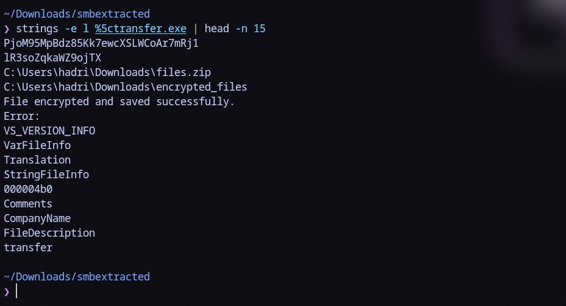
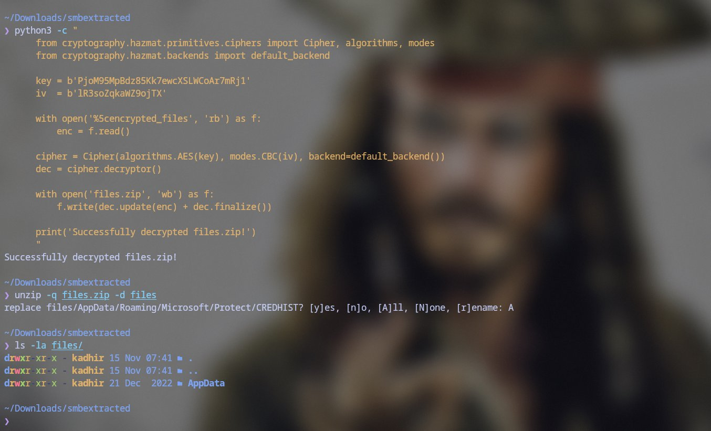
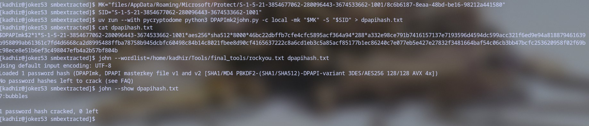
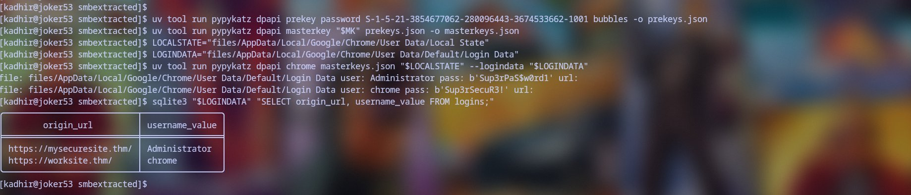

# Chrome - TryHackMe Writeup

## Overview
- **Room**: Chrome
- **Difficulty**: Hard
- **Category**: Digital Forensics & Incident Response (DFIR) / Network & Windows Forensics
- **Target OS / Software**: Windows 10, Google Chrome, Windows DPAPI
- **Key Concepts & Tools**: Network PCAP Analysis (Wireshark), SMB2 Object Carving, .NET Reverse Engineering (`strings`), AES-256-CBC Decryption, Windows DPAPI MasterKey Extraction (`DPAPImk2john.py`), Password Cracking (John the Ripper), Chrome Credential Decryption (`pypykatz`, SQLite3)

---

## Challenge Summary & Answers

| # | Question | Solution / Flag | Method |
|---|---|---|---|
| **1** | What is the first password that we find? | `bubbles` | DPAPI MasterKey hash cracked via John the Ripper (`rockyou.txt`) |
| **2** | What is the URL found in the first index? Fully defang the URL | `hxxps[://]mysecuresite[.]thm/` | Querying Chrome's `logins` SQLite database (Index 0) |
| **3** | What is the password found in the first index? | `Sup3rPaS$w0rd1` | Decrypting Chrome master AES key & DPAPI record via `pypykatz` |
| **4** | What is the URL found in the second index? Fully defang the URL | `hxxps[://]worksite[.]thm/` | Querying Chrome's `logins` SQLite database (Index 1) |
| **5** | What is the password found in the second index? | `Sup3rSecuR3!` | Decrypting Chrome master AES key & DPAPI record via `pypykatz` |

---

## Phase 1: Network Traffic Analysis (PCAPNG)

### 1. Protocol Hierarchy Analysis
We are provided with `chromefiles.zip` containing `traffic.pcapng` (MD5: `cc7b7d9dc26e9a5829bc981b82a923c6`). Opening the capture in **Wireshark** and navigating to **Statistics ➔ Protocol Hierarchy**:



- **Findings**: Out of 76 MB of traffic, **SMB2 (Server Message Block Protocol version 2)** accounts for **~63 MB** (over 99% of total application data bytes), indicating heavy file transfer activity over port 445.

---

### 2. Exporting SMB Objects
To reconstruct the exfiltrated files transferred across the network:
1. In Wireshark, navigate to **File ➔ Export Objects ➔ SMB...**
2. The SMB Object list displays two files transferred to `\\10.0.2.36\share`:
   - `\encrypted_files` (75 MB)
   - `\transfer.exe` (5,632 bytes)



We click **Save All** to extract these artifacts to our local environment:



---

### 3. Packet Inspection of Exfiltration
Filtering by `smb2` in Wireshark highlights the attacker's activity:
- **Packet 147**: `Create Request, File: transfer.exe`
- **Packet 743**: `Create Request, File: encrypted_files` (75 MB write stream)



---

## Phase 2: Reverse Engineering `transfer.exe`

Inspecting `transfer.exe` with `file` reveals it is a compiled 32-bit Windows .NET assembly (`PE32 executable for MS Windows 6.00 (console), Intel i386 Mono/.Net assembly`).

Because .NET applications store string constants in 16-bit Little-Endian Unicode (UTF-16LE), we use `strings -e l` to extract user strings:

```bash
strings -e l %5ctransfer.exe | head -n 15
```



### Extracted Parameters:
- **AES-256 Key (32 chars / 256 bits)**: `PjoM95MpBdz85Kk7ewcXSLWCoAr7mRj1`
- **AES-128 IV (16 chars / 128 bits)**: `lR3soZqkaWZ9ojTX`
- **Source File**: `C:\Users\hadri\Downloads\files.zip`
- **Output File**: `C:\Users\hadri\Downloads\encrypted_files`

---

## Phase 3: Decrypting the Exfiltrated Archive

With the AES key and initialization vector recovered, we write a Python script using `cryptography` to decrypt `%5cencrypted_files` (AES-CBC mode) and restore `files.zip`:

```bash
python3 -c "
from cryptography.hazmat.primitives.ciphers import Cipher, algorithms, modes
from cryptography.hazmat.backends import default_backend

key = b'PjoM95MpBdz85Kk7ewcXSLWCoAr7mRj1'
iv  = b'lR3soZqkaWZ9ojTX'

with open('%5cencrypted_files', 'rb') as f:
    enc = f.read()

cipher = Cipher(algorithms.AES(key), modes.CBC(iv), backend=default_backend())
dec = cipher.decryptor()

with open('files.zip', 'wb') as f:
    f.write(dec.update(enc) + dec.finalize())

print('Successfully decrypted files.zip!')
"
```

Next, we unzip `files.zip` into a `files/` directory:

```bash
unzip -q files.zip -d files
ls -la files/
```



The archive unpacks a complete Windows user profile tree containing:
- `AppData/Roaming/Microsoft/Protect/S-1-5-21-3854677062-280096443-3674533662-1001/8c6b6187-8eaa-48bd-be16-98212a441580` (DPAPI MasterKey)
- `AppData/Local/Google/Chrome/User Data/Local State` (Chrome Master Key container)
- `AppData/Local/Google/Chrome/User Data/Default/Login Data` (SQLite Credential Database)

---

## Phase 4: DPAPI MasterKey Extraction & Password Cracking

### Understanding Windows DPAPI
Google Chrome on Windows uses the **Data Protection API (DPAPI)** to secure passwords.
1. Chrome's `Local State` file contains an encrypted master key (`os_crypt.encrypted_key`) encrypted with the Windows user's DPAPI MasterKey.
2. The DPAPI MasterKey itself is encrypted using the user's Windows login password.

### 1. Extracting the Hash with `DPAPImk2john.py`
We point `DPAPImk2john.py` to the masterkey file along with the user's SID:

```bash
MK="files/AppData/Roaming/Microsoft/Protect/S-1-5-21-3854677062-280096443-3674533662-1001/8c6b6187-8eaa-48bd-be16-98212a441580"
SID="S-1-5-21-3854677062-280096443-3674533662-1001"

uv run --with pycryptodome python3 DPAPImk2john.py -c local -mk "$MK" -S "$SID" > dpapihash.txt
cat dpapihash.txt
```

### 2. Cracking with John the Ripper
We run John using `rockyou.txt`:

```bash
john --wordlist=/home/kadhir/Tools/final_tools/rockyou.txt dpapihash.txt
john --show dpapihash.txt
```



- **Answer (Question 1)**: `bubbles`

---

## Phase 5: Decrypting Chrome Saved Credentials

Now that we have the Windows logon password (`bubbles`), we can unlock the DPAPI MasterKey and decrypt Google Chrome's `Login Data` database.

### 1. MasterKey Decryption and Chrome Credential Recovery
Using `pypykatz`:
1. Generate prekey candidates:
   ```bash
   uv tool run pypykatz dpapi prekey password S-1-5-21-3854677062-280096443-3674533662-1001 bubbles -o prekeys.json
   ```
2. Decrypt the MasterKey:
   ```bash
   uv tool run pypykatz dpapi masterkey "$MK" prekeys.json -o masterkeys.json
   ```
3. Decrypt the Chrome secrets stored in `Local State` and `Login Data`:
   ```bash
   LOCALSTATE="files/AppData/Local/Google/Chrome/User Data/Local State"
   LOGINDATA="files/AppData/Local/Google/Chrome/User Data/Default/Login Data"

   uv tool run pypykatz dpapi chrome masterkeys.json "$LOCALSTATE" --logindata "$LOGINDATA"
   ```

### 2. Querying URLs from SQLite
To associate each decrypted password with its respective URL and index order, we query the `logins` table in `Login Data`:

```bash
sqlite3 "$LOGINDATA" "SELECT origin_url, username_value FROM logins;"
```



### Results:
- **First Index (Index 0)**:
  - Origin URL: `https://mysecuresite.thm/`
  - Fully Defanged URL: `hxxps[://]mysecuresite[.]thm/`
  - Username: `Administrator`
  - Decrypted Password: `Sup3rPaS$w0rd1`
- **Second Index (Index 1)**:
  - Origin URL: `https://worksite.thm/`
  - Fully Defanged URL: `hxxps[://]worksite[.]thm/`
  - Username: `chrome`
  - Decrypted Password: `Sup3rSecuR3!`

---

## Conclusion
The **Chrome** challenge provides an end-to-end incident response scenario combining network forensics and endpoint credential harvesting:
1. **Network Carving**: Identifying high-volume SMB2 sessions and carving exfiltrated payload files (`transfer.exe` and `encrypted_files`).
2. **Reverse Engineering**: Extracting symmetric cryptographic parameters (AES-256-CBC) embedded directly within a .NET payload.
3. **Windows DPAPI Exploitation**: Parsing DPAPI MasterKey structures, extracting password hashes, and cracking offline using John the Ripper.
4. **Browser Forensic Decryption**: Unlocking the master encryption key in `Local State` to recover stored website credentials from Chrome's SQLite database.
