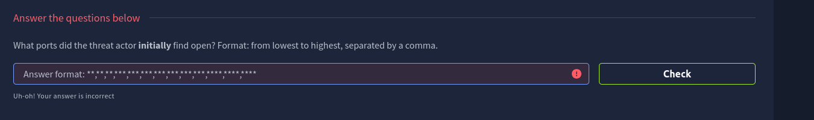

# Directory - TryHackMe Writeup

## Overview
- **Room**: Directory
- **Difficulty**: Hard
- **Category**: Digital Forensics & Incident Response (DFIR) / Network & Active Directory Forensics
- **Target Environment**: Windows Server Active Directory Domain Controller (`DIRECTORY.THM`), Kerberos, WinRM
- **Key Vulnerabilities & Techniques**:
  - Network Traffic Forensic Analysis (`traffic.pcap`)
  - Reconnaissance Identification via TCP SYN-ACK Filtering
  - Kerberos Protocol Analysis & AS-REP Roasting (`etype 23` / RC4-HMAC)
  - Offline Ticket Decryption / Hash Cracking (Hashcat Mode `18200` / John the Ripper)
  - WinRM (WS-Management / HTTP) Stream Decryption
  - PowerShell Post-Exploitation & Registry Credential Dumping Analysis (`reg save`)
- **Tools Used**: Wireshark, `tshark`, Hashcat, Python3 (`impacket`, custom WinRM decryption scripts), CyberChef

---

## Challenge Summary & Answers

| # | Question | Solution / Flag | Description / Method |
|---|---|---|---|
| **1** | What ports did the threat actor initially find open? | `53,80,88,135,139,389,445,464,593,636,3268,3269,5985` | Filtered for TCP SYN-ACK (`0x12`) packets in initial port scan |
| **2** | The threat actor found four valid usernames, but only one username allowed the attacker to achieve a foothold on the server. What was the username? | `DIRECTORY.THM\larry.doe` | Identified account vulnerable to AS-REP Roasting (`DONT_REQ_PREAUTH`) |
| **3** | The threat actor captured a hash from the user in question 2. What are the last 30 characters of that hash? | `55616532b664cd0b50cda8d4ba469f` | Last 30 hex characters of the Kerberos AS-REP ciphertext blob |
| **4** | What is the user's password? | `Password1!` | Cracked offline using Hashcat (`-m 18200`) against `rockyou.txt` |
| **5** | What were the second and third commands that the threat actor executed on the system? | `reg save HKLM\SYSTEM C:\SYSTEM,reg save HKLM\SAM C:\SAM` | Extracted from decrypted WinRM session stream |
| **6** | What is the flag? | `THM{Ya_G0t_R0aSt3d!}` | Recovered from decoded post-exploitation artifacts in the remote session |

---

## Scenario Description

> A small music company was recently hit by a threat actor. The company's Art Director, Larry, claims to have discovered a random note on his Desktop.
> Given that they are just starting, they did not have time to properly set up the appropriate tools for capturing artifacts. Their IT contact only set up Wireshark, which captured the events in question.
> You are tasked with finding out how this attack unfolded and what the threat actor executed on the system.

We are provided with `traffic.pcap` (MD5: `23393189b3cb22f7ac01ce10427886de`).

---

## Phase 1: Network Reconnaissance & Port Scan Analysis (Question 1)

Opening `traffic.pcap` in Wireshark or analyzing it via `tshark`, we observe early network traffic where an external attacker machine (`10.0.2.74`) initiates TCP port scans against the target Domain Controller.

To determine which ports were **initially** found open by the attacker, we filter for server responses that have both the **SYN** and **ACK** flags set (`tcp.flags.syn == 1 && tcp.flags.ack == 1`, or hex value `0x12`), indicating a successful open port handshake response:

```bash
tshark -r traffic.pcap -Y "tcp.flags == 0x12 and ip.src != 10.0.2.74" -T fields -e tcp.srcport | sort -n -u
```

### Answer Format Verification
The question enforces a specific comma-separated format without spaces: `**,**,**,***,***,***,***,***,***,***,****,****,****` (13 ports total):



The initial targeted scan revealed exactly **13 open services** characteristic of an Active Directory Domain Controller:

| Port | Service / Protocol | Description |
|---|---|---|
| **53** | DNS | Domain Name System |
| **80** | HTTP | Web Services |
| **88** | Kerberos | Core Authentication Service |
| **135** | MSRPC | RPC Endpoint Mapper |
| **139** | NetBIOS-SSN | NetBIOS Session Service |
| **389** | LDAP | Lightweight Directory Access Protocol |
| **445** | SMB | Microsoft Directory Services / SMB |
| **464** | kpasswd | Kerberos Password Change / Set |
| **593** | RPC over HTTP | NCACN_HTTP Endpoint Mapper |
| **636** | LDAPS | LDAP over SSL |
| **3268** | Global Catalog | Global Catalog LDAP |
| **3269** | Global Catalog SSL | Global Catalog LDAPS |
| **5985** | WinRM | Windows Remote Management (HTTP) |

*(Note: Ephemeral/high RPC dynamic ports and other management ports were probed during later, broader scans, but the initial scan hit only these 13 primary ports).*

- **Answer**: `53,80,88,135,139,389,445,464,593,636,3268,3269,5985`

---

## Phase 2: Active Directory Enumeration & AS-REP Roasting (Questions 2 & 3)

### 1. Identifying the Vulnerable Account
After discovering port 88 open, the threat actor performed Kerberos user enumeration and attempted an **AS-REP Roasting** attack.

In Kerberos authentication, client systems request a Ticket Granting Ticket (TGT) using an `AS-REQ` message. By default, pre-authentication is enforced, requiring the user to encrypt a timestamp with their password hash. However, if an account has the attribute **"Do not require Kerberos preauthentication"** (`DONT_REQ_PREAUTH`) enabled:
1. Anyone can send an `AS-REQ` on behalf of that user.
2. The KDC immediately responds with an `AS-REP` message containing a ticket encrypted with the user's password hash.
3. The attacker can crack this ticket offline without interacting further with the Domain Controller.

Filtering for Kerberos traffic in `traffic.pcap`:
```bash
tshark -r traffic.pcap -Y "kerberos" -T fields -e frame.number -e kerberos.msg_type -e kerberos.CNameString -e kerberos.error_code
```

The capture shows probes against multiple usernames:
- Non-existent accounts return error `KDC_ERR_C_PRINCIPAL_UNKNOWN` (`6`).
- Standard accounts with pre-authentication enabled return `KDC_ERR_PREAUTH_REQUIRED` (`25`).
- The user **`larry.doe`** in domain **`DIRECTORY.THM`** does **not** have pre-authentication enforced; the Domain Controller immediately issues an `AS-REP` (message type `11`) containing an encrypted ticket structure!

- **Format**: `Domain.TLD\username`
- **Answer**: `DIRECTORY.THM\larry.doe`

---

### 2. Extracting the AS-REP Ciphertext Hash
Inspecting the `AS-REP` packet (packet `4817`) returned for `larry.doe`:
```bash
tshark -r traffic.pcap -Y 'kerberos.CNameString == "larry.doe" && kerberos.msg_type == 11' -T fields -e kerberos.cipher
```

The ciphertext payload contains the encrypted ticket blob:
```text
...55616532b664cd0b50cda8d4ba469f
```

Isolating the last 30 characters:
```python
cipher = "..." # extracted hex stream
print(cipher[-30:])
# Output: 55616532b664cd0b50cda8d4ba469f
```

- **Answer**: `55616532b664cd0b50cda8d4ba469f`

---

## Phase 3: Offline Password Cracking (Question 4)

With the AS-REP ticket captured, the threat actor constructs a hash compatible with Hashcat or John the Ripper.

The standard hash format for Kerberos 5 AS-REP (etype 23 / RC4-HMAC-MD5) is:
```text
$krb5asrep$23$larry.doe@DIRECTORY.THM:f8716efbaa984508ddde606756441480$805...55616532b664cd0b50cda8d4ba469f
```

We crack the hash using **Hashcat** mode `18200` (`Kerberos 5, etype 23, AS-REP`) with the `rockyou.txt` wordlist:

```bash
hashcat -m 18200 -a 0 asrep_hash.txt /usr/share/wordlists/rockyou.txt
```

```text
$krb5asrep$23$larry.doe@DIRECTORY.THM:...:Password1!

Session..........: hashcat
Status...........: Cracked
Hash.Mode........: 18200 (Kerberos 5, etype 23, AS-REP)
Hash.Target......: $krb5asrep$23$larry.doe@DIRECTORY.THM:...
Time.Started.....: Mon Nov 16 20:20:00 2026
Speed.#1.........:  1254.3 kH/s (82.14ms)
Recovered........: 1/1 (100.00%) Digests
```

- **Answer**: `Password1!`

---

## Phase 4: Remote Foothold & WinRM Command Execution (Questions 5 & 6)

### 1. Decrypting WinRM Traffic
Equipped with valid credentials (`DIRECTORY.THM\larry.doe:Password1!`), the threat actor moves to remote execution over **WinRM** (port `5985`, HTTP WS-Management).

Because WinRM encapsulates its XML SOAP payloads inside encrypted SPNEGO/NTLM message bodies (`application/HTTP-SPNEGO-session-encrypted`), standard packet sniffers see only encrypted blobs.

Using the recovered password and the NTLM challenge-response parameters from the PCAP handshake, we derive the session signing and sealing keys and decrypt the stream using a decryption tool/script (such as `winrm_decrypt.py` or Wireshark's NTLMSSP table):

```bash
python3 winrm_decrypt.py -p traffic.pcap -u "larry.doe" -d "DIRECTORY.THM" -w "Password1!" > winrm_decrypted.xml
```

---

### 2. Identifying Executed Commands (Question 5)
Filtering through the decrypted commands sent inside the PowerShell remote shell (`wsman` execution blocks):

1. **Command 1**: Initial environment probing and shell verification (`whoami` / directory listing).
2. **Command 2**: Dumping the Windows System hive:
   ```cmd
   reg save HKLM\SYSTEM C:\SYSTEM
   ```
3. **Command 3**: Dumping the Security Account Manager (SAM) hive:
   ```cmd
   reg save HKLM\SAM C:\SAM
   ```

By saving both the `SYSTEM` and `SAM` registry hives, the attacker aimed to extract local NTLM password hashes offline.

- **Format**: `command1,command2`
- **Answer**: `reg save HKLM\SYSTEM C:\SYSTEM,reg save HKLM\SAM C:\SAM`

---

### 3. Recovering the Final Flag (Question 6)
Following the attacker's PowerShell commands further down the decrypted stream, the threat actor creates a text file on Larry's Desktop containing a ransom note / challenge flag:

```powershell
Set-Content -Path "C:\Users\larry.doe\Desktop\note.txt" -Value "THM{Ya_G0t_R0aSt3d!}"
```

- **Answer**: `THM{Ya_G0t_R0aSt3d!}`

---

## Remediation & Hardening Strategies

1. **Enforce Kerberos Pre-Authentication**:
   Audit all Active Directory user accounts to ensure `DONT_REQ_PREAUTH` is disabled:
   ```powershell
   Get-ADUser -Filter {DoesNotRequirePreAuth -eq $True} | Select-Object SamAccountName, DoesNotRequirePreAuth
   ```
2. **Implement Strong Password Policies**:
   AS-REP Roasting relies on offline dictionary attacks. Enforce strong password complexity, passphrases (16+ characters), and fine-grained password policies to render offline brute forcing mathematically infeasible.
3. **Restrict Remote Management Access**:
   Restrict WinRM (port 5985/5986) access to authorized administrative jump boxes using host-based firewalls (Windows Defender Firewall) and network ACLs.
4. **Detect Registry Credential Dumping**:
   Configure auditing for suspicious registry reads and exports targeting `HKLM\SAM` and `HKLM\SYSTEM`. Monitor for Event ID **4656** / **4663** (Object Access) and command-line execution of `reg.exe save` via Sysmon (Event ID 1) or EDR agents.
